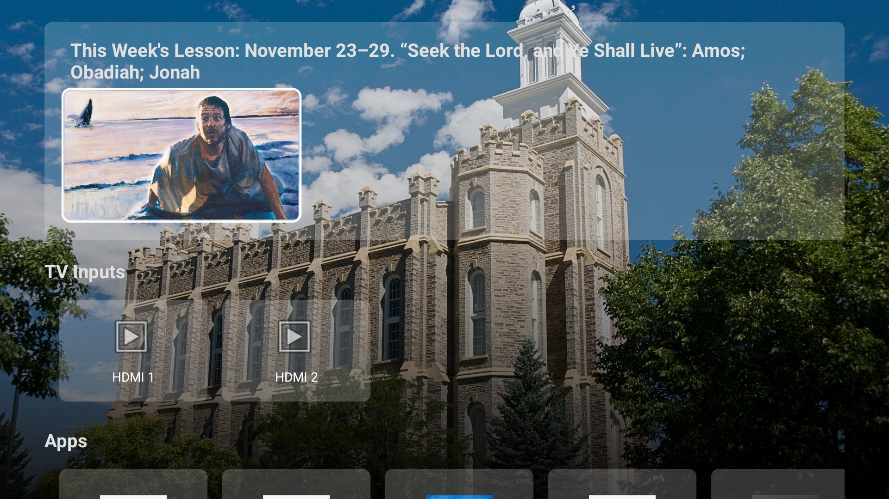

# Latter Day Launcher
A TV launcher for TVs in LDS church buildings.
## Installation Instructions
This guide assumes you already have ADB (android developer bridge) set up, if not, you can view a tutorial [Here.](https://pixelkc.github.io/guides/adb/tv.html)
Type these 4 commands 
<code>adb shell cmd package set-home-activity com.colle.latterdaylauncher/.MainActivity</code> 
<code>adb shell cmd role add-role-holder android.app.role.HOME com.colle.latterdaylauncher</code> 
<code>adb shell pm disable-user --user 0 com.google.android.apps.tv.launcherx</code> 
<code>adb shell pm disable-user --user 0 com.google.android.tungsten.setupwraith</code> 
Now test it, press the home button on your TV remote.
## Screenshots

## AI Disclaimer
AI was used to build most of this app.
### Bug Reporting
Notice a bug? Report it at <a href="https://github.com/pixelKc/Latter-Day-Launcher/issues">https://github.com/pixelKc/Latter-Day-Launcher/issues</a>