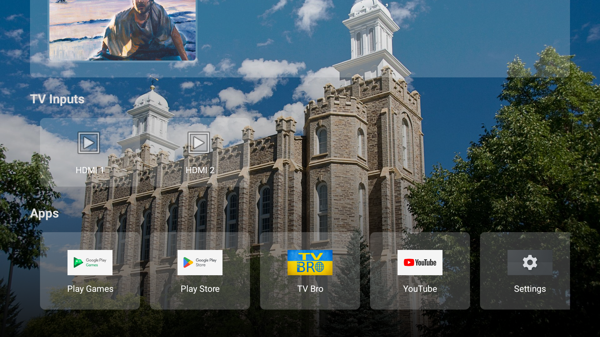

# Latter Day Launcher

A custom TV launcher for TVs in LDS church buildings.

## Installation Instructions

This guide assumes you already have ADB (Android Debug Bridge) set up. If not, you can follow the [ADB Setup Guide for TVs](https://pixelkc.github.io/guides/adb/tv.html).

1. **Sideload the app** onto your TV, either by running `adb install LatterDayLauncher.apk` or by opening the download link in a web browser directly on your TV.
2. **Set Latter Day Launcher as the default home screen** by running these 4 commands:

```bash
adb shell cmd package set-home-activity com.colle.latterdaylauncher/.MainActivity
adb shell cmd role add-role-holder android.app.role.HOME com.colle.latterdaylauncher
adb shell pm disable-user --user 0 com.google.android.apps.tv.launcherx
adb shell pm disable-user --user 0 com.google.android.tungsten.setupwraith
```

3. **Test it:** Press the **Home** button on your TV remote.

## Screenshots




## Bug Reporting

Notice a bug? Report it on the [Issues page](https://github.com/pixelKc/Latter-Day-Launcher/issues).

## License & Attribution

Copyright (c) 2026 Colle G.  
Licensed under the [GNU General Public License v3.0](LICENSE) (GPL-3.0).

If you share a modified version or fork of this project, please keep the original copyright notice intact and include a link back to this repository!
